




<a href="https://github.com/rop2024/Promptly"></a>
<a href="https://github.com/rop2024/Tasklytics"></a>
<a href="https://github.com/rop2024/bookmark-clustering"></a>







<a href="https://github.com/rop2024">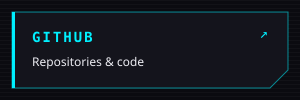</a>
<a href="https://www.linkedin.com/in/rohitpandey08">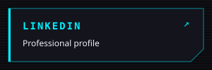</a>
<a href="https://www.artstation.com/rohit_pandey_0">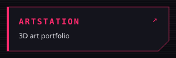</a>
<a href="https://discordapp.com/users/1387348547308883968">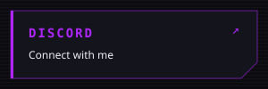</a>
<a href="https://monkeytype.com/profile/__Rohit__">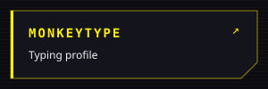</a>
<a href="./Rohit%20Pandey%20cv.pdf">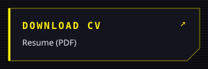</a>



<!-- Proudly created with GPRM ( https://gprm.itsvg.in ) -->
